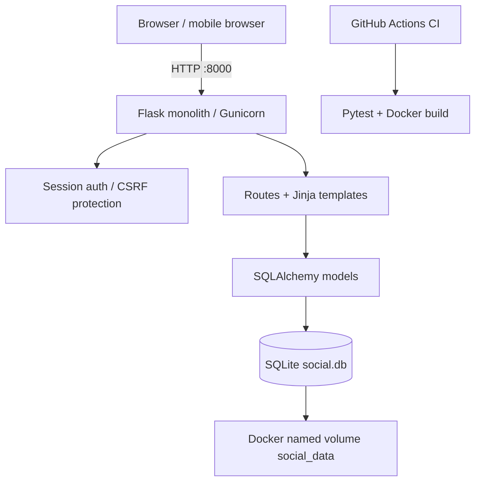

# Architecture

## Components
- Presentation: server-rendered Jinja templates with responsive CSS; no frontend build tool.
- Application: Flask routes for register/login/logout/feed/create post.
- Authentication: Flask-Login signed sessions and Werkzeug scrypt password hashes; CSRF checks on all mutations.
- Persistence: SQLAlchemy models, SQLite file in Docker named volume.
- Deployment: single Docker container, Gunicorn, port 8000; Compose manages the named volume.

## Data model
`User(id PK, username UNIQUE, password_hash)` has many `Post(id PK, author_id FK, body, created_at UTC)`.

## Boundaries and risks
Single-process SQLite works for a local MVP, not a high-write multi-instance production service. Tables are created on boot for a demo; production would use versioned migrations. Secret key in Compose is a **local-only fallback**; replace it for public deployment. No email verification, rate limiting or TLS termination are included. No performance benchmark has been performed.
