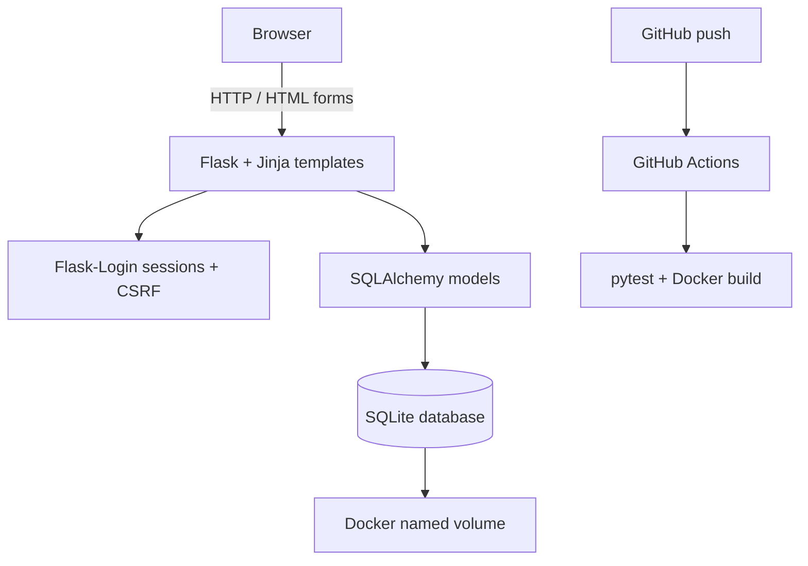

# Architecture

## Decision
Server-rendered monolithic Flask web application backed by SQLite. No separate frontend build step.

## Components
- Templates and CSS render responsive pages.
- Routes implement registration, login/logout, feed and posting.
- Flask-Login protects post creation; Werkzeug scrypt hashes credentials.
- SQLAlchemy persists User and Post entities in SQLite.
- Docker Compose maps localhost:8000 and mounts the named volume.

## Data model
User(id PK, username UNIQUE, password_hash); Post(id PK, author_id FK → User.id, body, created_at). One user has many posts.

## Trade-offs
A monolith is easy to run and debug but scales less flexibly than separated services. SQLite is sufficient for local MVP but less suitable for high-write concurrency. Production deployment requires hardened secret management, HTTPS, migrations and operational monitoring.
